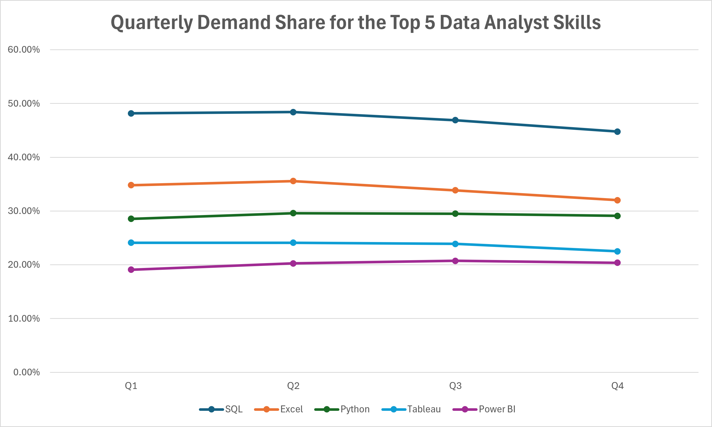
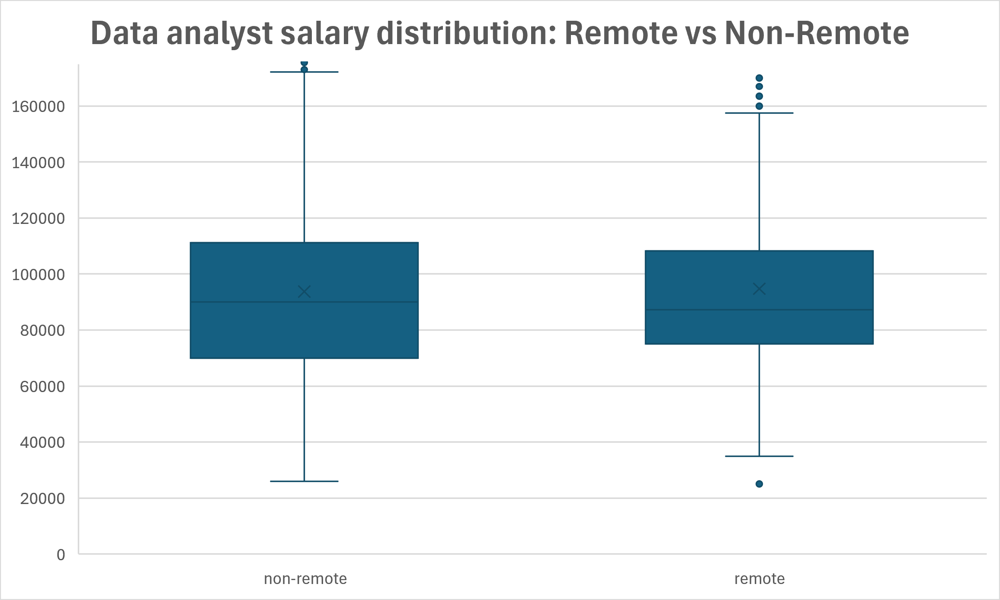
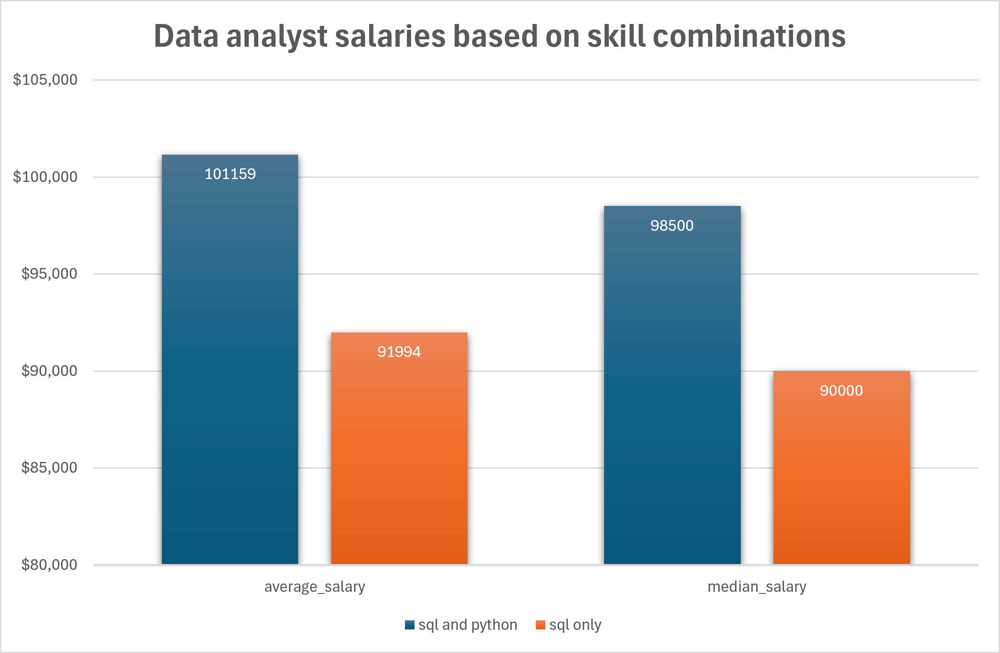

# Introduction
Welcome to my SQL Portfolio Project, where I delve into the data job market with a focus on data analyst roles. This project is a personal exploration into identifying the top-paying jobs, in-demand skills, and the intersection of high demand with high salary in the field of data analytics. This project was initially developed as part of [Luke Barousse's SQL for Data Analytics course](https://www.lukebarousse.com/sql). Building on the original five analyses, I developed three additional investigations exploring quarterly changes in technical skill demand, salary distributions across work arrangements, and the salary impact of combining SQL and Python skills. These additional analyses allowed me to apply more advanced SQL techniques and explore new questions beyond the course material.

Check out my SQL queries here: [project_sql folder](/project_sql/)

# Background
The motivation behind this project stemmed from my desire to understand the data analyst job market better. I aimed to discover which skills are paid the most and in demand, making my job search more targeted and effective. 

The data for this analysis is from Luke Barousse’s SQL Course. This data includes details on job titles, salaries, locations, and required skills for job postings in 2023.

The questions I wanted to answer through my SQL queries were:

1. What are the top-paying data analyst jobs?
2. What skills are required for these top-paying jobs?
3. What skills are most in demand for data analysts?
4. Which skills are associated with higher salaries?
5. What are the Best Skills Based on Demand and Salary"?
6. How did demand for the top 5 skills change across the four quarters?
7. How do salary distributions differ between remote and non-remote Data Analyst positions?
8. Are jobs requiring both SQL and Python associated with higher salaries than jobs requiring SQL without Python?

# Tools I Used
In this project, I utilized a variety of tools to conduct my analysis:

- **SQL** (Structured Query Language): Enabled me to interact with the database, extract insights, and answer my key questions through queries.
- **PostgreSQL**: As the database management system, PostgreSQL allowed me to store, query, and manipulate the job posting data.
- **Visual Studio Code:** Used to write, organize, and execute SQL queries throughout the project.
- **Microsoft Excel:** Used to visualize SQL query results through charts, making salary comparisons and skill-demand patterns easier to understand.

# The Analysis
Each query for this project aimed at investigating specific aspects of the data analyst job market. Some analyses focus on remote-eligible positions, while others examine all Data Analyst postings. Salary comparisons include only postings with reported annual salaries, so their results may not represent the entire job market. Here’s how I approached each question:

### 1. Top Paying Data Analyst Jobs

To identify the highest-paying roles, I filtered data analyst positions by average yearly salary and location, focusing on remote jobs. This query highlights the high paying opportunities in the field.

```sql
SELECT
    job_id,
    job_title,
    job_location,
    companies.name AS company_name,
    job_schedule_type,
    salary_year_avg,
    job_posted_date
FROM
    job_postings_fact AS jobs
LEFT JOIN company_dim AS companies ON jobs.company_id = companies.company_id
WHERE
    job_title_short = 'Data Analyst' AND
    (job_location = 'Anywhere' OR job_work_from_home = TRUE) AND
    salary_year_avg IS NOT NULL
ORDER BY
    salary_year_avg DESC
LIMIT 10;
```


**Among the 10 highest-paying remote Data Analyst job postings, Mantys had the highest listed salary at $650,000, nearly twice the next-highest salary of $336,500. The median salary was $211,000, showing how much the highest-paying position stood out from the rest.**


### 2. Skills for Top Paying Jobs

To understand what skills are required for the top-paying jobs, I joined the job postings with the skills data, providing insights into what employers value for high-compensation roles.

```sql
WITH top_paying_jobs AS(
    SELECT
        job_id,
        job_title,
        companies.name AS company_name,
        salary_year_avg
    FROM
        job_postings_fact AS jobs
    LEFT JOIN company_dim AS companies ON jobs.company_id = companies.company_id
    WHERE
        job_title_short = 'Data Analyst' AND
        (job_location = 'Anywhere' OR job_work_from_home = TRUE) AND
        salary_year_avg IS NOT NULL
    ORDER BY
        salary_year_avg DESC
    LIMIT 10
)

SELECT
    top_paying_jobs.*,
    skills_dim.skills
FROM
    top_paying_jobs
INNER JOIN skills_job_dim ON top_paying_jobs.job_id = skills_job_dim.job_id
INNER JOIN skills_dim ON skills_job_dim.skill_id = skills_dim.skill_id
ORDER BY
    salary_year_avg DESC;
```


**Of the top 10 highest paying Data Analyst jobs, only 8 had skills posted. SQL appeared in all eight, followed by Python in seven and Tableau in six. This suggests that a combination of SQL, programming, and visualization skills is common among these high-paying roles, although the sample size is small.**


### 3. In-Demand Skills for Data Analysts

This query helped identify the skills most frequently requested in job postings, directing focus to areas with high demand.

```sql
SELECT
    skills.skills,
    COUNT(jobs.job_id) AS demand_count
FROM
    job_postings_fact AS jobs
LEFT JOIN skills_job_dim ON jobs.job_id = skills_job_dim.job_id
LEFT JOIN skills_dim AS skills ON skills.skill_id = skills_job_dim.skill_id
WHERE
    job_title_short = 'Data Analyst' AND
    (job_location = 'Anywhere' OR job_work_from_home = TRUE)
GROUP BY
    skills.skills
ORDER BY
    demand_count DESC
LIMIT 5;
```


**SQL was the most requested skill, appearing in 7,291 remote-eligible job postings, followed by Excel (4,611) and Python (4,330). Tableau and Power BI also ranked among the top five, highlighting the demand for both analytical and data visualization skills.**


### 4. Skills Based on Salary

Exploring the average salaries associated with different skills revealed which skills are the highest paying.

```sql
SELECT
    skills.skills,
    ROUND(AVG(salary_year_avg),0) AS avg_salary,
    COUNT(jobs.job_id) AS postings_count
FROM
    job_postings_fact AS jobs
LEFT JOIN skills_job_dim ON jobs.job_id = skills_job_dim.job_id
LEFT JOIN skills_dim AS skills ON skills.skill_id = skills_job_dim.skill_id
WHERE
    job_title_short = 'Data Analyst' AND
    salary_year_avg IS NOT NULL
GROUP BY
    skills.skills
ORDER BY
    avg_salary DESC
LIMIT 25;
```


**SVN had the highest average salary at $400,000, but this was based on only one job posting, making it an unreliable indicator of typical earnings. Skills such as Airflow, Scala, and Kafka had average salaries of approximately $116,000–$130,000 across larger samples of 40–71 postings, making their results more useful for comparison.**


### 5. Most Optimal Skills to Learn

Combining insights from demand and salary data, this query aimed to pinpoint skills that are both in high demand and have high salaries, offering a strategic focus for skill development.

#### A. Using CTEs

```sql
WITH top_demanded_skills AS(
    SELECT
    skills.skill_id,
    skills.skills,
    COUNT(jobs.job_id) AS demand_count
FROM
    job_postings_fact AS jobs
LEFT JOIN skills_job_dim ON jobs.job_id = skills_job_dim.job_id
LEFT JOIN skills_dim AS skills ON skills.skill_id = skills_job_dim.skill_id
WHERE
    job_title_short = 'Data Analyst' AND
    salary_year_avg IS NOT NULL AND
    (job_location = 'Anywhere' OR job_work_from_home = TRUE)
GROUP BY
    skills.skill_id,
    skills.skills
),

top_paying_skills AS(
    SELECT
    skills.skill_id,
    skills.skills,
    ROUND(AVG(salary_year_avg),0) AS avg_salary
FROM
    job_postings_fact AS jobs
LEFT JOIN skills_job_dim ON jobs.job_id = skills_job_dim.job_id
LEFT JOIN skills_dim AS skills ON skills.skill_id = skills_job_dim.skill_id
WHERE
    job_title_short = 'Data Analyst' AND
    salary_year_avg IS NOT NULL AND
    (job_location = 'Anywhere' OR job_work_from_home = TRUE)
GROUP BY
    skills.skill_id,
    skills.skills
)

SELECT
    top_demanded_skills.skill_id,
    top_demanded_skills.skills,
    demand_count,
    avg_salary
FROM
    top_demanded_skills
INNER JOIN top_paying_skills ON top_demanded_skills.skill_id = top_paying_skills.skill_id
WHERE
    demand_count > 10
ORDER BY
    avg_salary DESC,
    demand_count DESC
LIMIT 25;
```

#### B. Without Using CTEs:

```sql
SELECT
    skills.skill_id,
    skills.skills,
    COUNT(jobs.job_id) AS demand_count,
    ROUND(AVG(salary_year_avg),0) AS avg_salary
FROM
    job_postings_fact AS jobs
INNER JOIN skills_job_dim AS sjd ON sjd.job_id = jobs.job_id
INNER JOIN skills_dim AS skills ON skills.skill_id = sjd.skill_id
WHERE
    job_title_short = 'Data Analyst' AND
    salary_year_avg IS NOT NULL AND
    (job_location = 'Anywhere' OR job_work_from_home = TRUE)
GROUP BY
    skills.skill_id,
    skills.skills
HAVING
    COUNT(jobs.job_id) > 10
ORDER BY
    avg_salary DESC,
    demand_count DESC
LIMIT 25;
```


**Python and Tableau stood out for their combination of high demand and competitive salaries, appearing in 236 and 230 salary-reporting remote-eligible postings with average salaries of $101,397 and $99,288, respectively. Go had a higher average salary but appeared in only 27 postings, showing the tradeoff between salary and job availability.**


### 6. Demand Change for Top Skills Across Each Quarter

This query tracked demand for the top five Data Analyst skills across the four quarters of 2023, using each skill’s share of job postings to identify changes in demand while accounting for fluctuations in overall posting volume.

```sql
WITH top_demanded_skills AS(
    SELECT
        skills.skills
    FROM
        job_postings_fact AS jobs
    INNER JOIN skills_job_dim ON jobs.job_id = skills_job_dim.job_id
    INNER JOIN skills_dim AS skills ON skills.skill_id = skills_job_dim.skill_id
    WHERE
        job_title_short = 'Data Analyst'
    GROUP BY
        skills.skills
    ORDER BY
        COUNT(jobs.job_id) DESC
    LIMIT 5
),

quarterly_job_totals AS(
    SELECT
        CONCAT('Q',EXTRACT(QUARTER FROM job_posted_date)) AS quarter,
        COUNT(job_id) AS total_postings
    FROM
        job_postings_fact
    WHERE
        job_title_short = 'Data Analyst'
    GROUP BY
        quarter
),

quarterly_skill_demand AS (
    SELECT
        CONCAT('Q', EXTRACT(QUARTER FROM jobs.job_posted_date)) AS quarter_posted,
        skills.skills,
        COUNT(DISTINCT jobs.job_id) AS postings_count,
        ROUND(COUNT(DISTINCT jobs.job_id) * 100.0 / qjt.total_postings,2) AS demand_percentage
    FROM
        job_postings_fact AS jobs
    INNER JOIN skills_job_dim
        ON jobs.job_id = skills_job_dim.job_id
    INNER JOIN skills_dim AS skills
        ON skills.skill_id = skills_job_dim.skill_id
    INNER JOIN quarterly_job_totals AS qjt ON CONCAT('Q', EXTRACT(QUARTER FROM jobs.job_posted_date)) = qjt.quarter
    WHERE
        jobs.job_title_short = 'Data Analyst' AND
        skills.skills IN (
            SELECT
                skills
            FROM
                top_demanded_skills)
    GROUP BY
        quarter_posted,
        skills.skills,
        qjt.total_postings
)

SELECT
    quarter_posted,
    skills,
    postings_count,
    demand_percentage,
    LAG(demand_percentage) OVER (
        PARTITION BY skills
        ORDER BY quarter_posted
    ) AS previous_quarter_demand,
    demand_percentage - LAG(demand_percentage) OVER(
        PARTITION BY skills
        ORDER BY quarter_posted
    ) AS demand_change_pp
FROM
    quarterly_skill_demand
ORDER BY
    quarter_posted,
    skills;
```


**SQL remained the most requested skill throughout 2023, although its share of Data Analyst postings declined from approximately 48% in Q1 to 45% in Q4. Excel and Tableau also declined, while Python and Power BI ended the year with slightly higher demand shares than they started with.**


### 7. Salary Distribution Based on Work Arrangement
This query tracks different parameters for remote vs non-remote jobs such as Min, Max, Average, and different percentiles.

#### A. Calculating the metrics:

```sql
SELECT
    CASE
        WHEN job_work_from_home = TRUE THEN 'remote'
        ELSE 'non-remote'
    END AS work_arrangement,
    COUNT(job_id) AS job_count,
    ROUND(MIN(salary_year_avg),0) AS min_salary,
    ROUND(MAX(salary_year_avg),0) AS max_salary,
    ROUND(AVG(salary_year_avg),0) AS average_salary,
    ROUND(PERCENTILE_CONT(0.25) WITHIN GROUP(
        ORDER BY salary_year_avg)::NUMERIC,0) AS salary_25th,
    ROUND(PERCENTILE_CONT(0.5) WITHIN GROUP(
        ORDER BY salary_year_avg)::NUMERIC,0) AS median_salary,
    ROUND(PERCENTILE_CONT(0.75) WITHIN GROUP(
        ORDER BY salary_year_avg)::NUMERIC,0) AS salary_75th   
FROM
    job_postings_fact
WHERE
    job_title_short = 'Data Analyst' AND
    salary_year_avg IS NOT NULL
GROUP BY
    work_arrangement;
```

#### B. Calculating individual salaries to use for the box and whiskers:

```sql
SELECT
    CASE
        WHEN job_work_from_home = TRUE THEN 'remote'
        ELSE 'non-remote'
    END AS work_arrangement,
    salary_year_avg
FROM
    job_postings_fact
WHERE
    job_title_short = 'Data Analyst' AND
    salary_year_avg IS NOT NULL;
```


**Among 4,859 non-remote and 604 remote postings with reported salaries, non-remote positions had a slightly higher median salary ($90,000 versus $87,250). However, remote positions included higher salary extremes, reaching $650,000 compared to $400,000 for non-remote positions; these extremes fall outside the chart's displayed salary range.**


### 8. Salary Based on Skill Combinations

A query that calculates different metrics, such as, average, median, min, and max salaries, for data analyst job postings based on whether they require both sql and python or sql without python.

```sql
WITH sql_no_python AS(
    SELECT
        jobs.job_id,
        jobs.salary_year_avg
    FROM
        job_postings_fact AS jobs
    WHERE
        salary_year_avg IS NOT NULL AND
        job_title_short = 'Data Analyst' AND
        EXISTS(
            SELECT *
            FROM skills_job_dim AS sjd
            INNER JOIN skills_dim AS skills ON sjd.skill_id = skills.skill_id
            WHERE sjd.job_id = jobs.job_id
            AND skills.skills = 'sql'
        ) AND
        NOT EXISTS(
            SELECT *
            FROM skills_job_dim AS sjd
            INNER JOIN skills_dim AS skills2 ON sjd.skill_id = skills2.skill_id
            WHERE sjd.job_id = jobs.job_id AND
            skills2.skills = 'python'
        )
),

sql_and_python AS(
    SELECT
        jobs.job_id,
        jobs.salary_year_avg
    FROM
        job_postings_fact AS jobs
        WHERE
        salary_year_avg IS NOT NULL AND
        job_title_short = 'Data Analyst' AND
        EXISTS(
            SELECT *
            FROM skills_job_dim as sjd
            INNER JOIN skills_dim AS skills2 ON sjd.skill_id = skills2.skill_id
            WHERE sjd.job_id = jobs.job_id AND
            skills2.skills = 'sql'
        ) AND
        EXISTS(
            SELECT *
            FROM skills_job_dim AS sjd
            INNER JOIN skills_dim AS skills ON sjd.skill_id = skills.skill_id
            WHERE sjd.job_id = jobs.job_id AND
            skills.skills = 'python'
        )
)

SELECT
    skill_combo,
    COUNT(*) AS job_count,
    ROUND(AVG(salary_year_avg),0) AS average_salary,
    ROUND(PERCENTILE_CONT(0.5) WITHIN GROUP(
        ORDER BY salary_year_avg)) AS median_salary,
    ROUND(MIN(salary_year_avg),0) AS min_salary,
    ROUND(MAX(salary_year_avg),0) AS max_salary
FROM(
    SELECT
        'sql without python' AS skill_combo,
        salary_year_avg
    FROM
        sql_no_python

    UNION ALL

    SELECT
        'sql with python' AS skill_combo,
        salary_year_avg
    FROM
        sql_and_python
) AS combined_jobs
GROUP BY
    skill_combo;
```


**Positions requiring both SQL and Python had an average salary of $101,159, approximately 10% higher than positions requiring SQL without Python ($91,994). Median salaries were also higher ($98,500 versus $90,000), suggesting a salary advantage associated with the combination of skills, although other factors may also contribute to the difference.**


Each query not only served to answer a specific question but also to improve my understanding of SQL and database analysis. Through this project, I learned to leverage SQL's powerful data manipulation capabilities to derive meaningful insights from complex datasets.

# Final Analysis

Analysis of 2023 Data Analyst job postings revealed several key findings about technical skill demand, salary trends, and factors associated with higher compensation.

### 1. Most Valuable Skills for Data Analysts
SQL was consistently the most requested technical skill, followed by Excel, Python, and data visualization tools like Tableau and Power BI. While SQL remained the most in-demand skill throughout 2023, Python and Power BI saw small increases in their share of job postings, highlighting the importance of developing a combination of technical skills.

### 2. Salary Trends and Skill Combinations
Jobs requiring both SQL and Python had approximately 10% higher average salaries than jobs requiring SQL without Python, suggesting a potential salary advantage from learning both skills. Remote and non-remote positions had relatively similar median salaries, showing that remote work was not necessarily associated with higher pay.

### 3. Balancing Skill Demand and Salary
Some specialized skills were associated with significantly higher average salaries, but many appeared in very few job postings, making those results less reliable. More widely requested skills like Python and Tableau offered a strong balance between job opportunities and competitive salaries, making them practical choices for aspiring Data Analysts.

### Overall Conclusion
The findings suggest that aspiring Data Analysts should focus on building strong SQL skills while developing additional skills in Python and data visualization. Although specialized technologies may offer higher salaries, prioritizing skills with consistent demand provides a more practical approach to career development. This project also highlighted the importance of looking beyond averages and considering sample sizes, outliers, and other factors when analyzing job market data.

# What I Learned
Throughout this project, I strengthened my SQL skills and gained practical experience in several key areas:

- **Table Joins and Relationships:** Strengthened my understanding of relational databases by using `INNER JOIN` and `LEFT JOIN` to combine data across multiple tables.
- **Data Filtering and Sorting:** Applied `WHERE`, `HAVING`, `IN`, and `ORDER BY` to filter datasets, refine query results, and identify meaningful trends.
- **Data Aggregation:** Utilized `GROUP BY` and aggregate functions such as `COUNT()`, `AVG()`, `MIN()`, and `MAX()` to summarize job market data and uncover valuable insights.
- **Advanced Query Construction:** Built complex SQL queries using Common Table Expressions (CTEs), subqueries, and `EXISTS` / `NOT EXISTS` operators to organize query logic and evaluate specific conditions.
- **Window Functions and Time-Based Analysis:** Used `LAG()` with `OVER()`, `PARTITION BY`, and `ORDER BY` to analyze quarterly skill demand and calculate quarter-over-quarter changes. Applied `EXTRACT()` and `CONCAT()` to organize and label time-based results.
- **Statistical Analysis:** Applied `PERCENTILE_CONT()` to calculate median salaries and quartiles, helping identify salary distributions, variability, and potential outliers.
- **Conditional Logic:** Used `CASE` expressions to categorize job postings based on characteristics such as remote work availability, allowing for comparisons between different groups.
- **Combining Query Results:** Used `UNION ALL` to combine results from separate analyses into a single dataset for comparison.
- **Query Organization and Readability:** Explored ways to improve query readability and efficiency by reducing redundant code, organizing complex logic with CTEs, and comparing alternative query approaches.
- **Analytical Thinking:** Developed my ability to translate real-world questions into SQL queries, interpret statistical results, recognize potential data limitations, and draw meaningful conclusions from the data.

# Conclusions
This project helped me improve my SQL skills while gaining a better understanding of the Data Analyst job market. Through the analysis, I identified trends in job demand, salaries, and technical skills that can help aspiring Data Analysts make informed career decisions. The findings also highlight the importance of focusing on in-demand skills and continuously learning to stay competitive in the field.